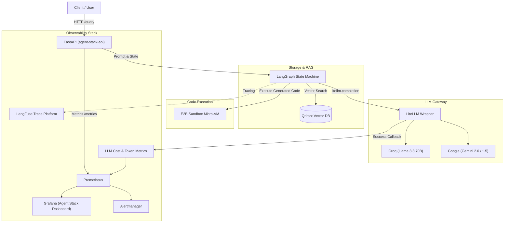

# Architecture Overview & System Map

This document provides operators and platform engineers with a high-level map of the `agentic` self-correcting support agent system.

---

## 1. System Component Diagram

---

## 2. Request Lifecycle

1. **Client Request**: User posts `{"query": "..."}` to `/query`.
2. **Context Retrieval**: LangGraph invokes `retrieve_docs` to query Qdrant for semantic chunks and their relevance scores.
3. **Generation**: `generate_solution` constructs an XML-delimited prompt with:
   - Explicit sandbox environment constraints (no network, package whitelist, timeouts)
   - Contextually ranked documents
   - Chain-of-Thought Root Cause Analysis (RCA) on retry attempts
4. **Execution**: The generated Python script executes inside an isolated E2B micro-VM sandbox.
5. **Self-Correction Decision**:
   - If success: result and execution outputs are formatted and returned. Terminal query cost histogram is recorded.
   - If error: error logs and stdout are captured, `agent_retries_total` is incremented, and the graph loops back to `generate_solution` with full RCA feedback (up to 3 attempts).

---

## 3. External Dependencies & Contacts

| Dependency | Purpose | Failure Mode | Operator Contact / Status Link |
|---|---|---|---|
| **Groq API** | Primary inference provider | HTTP 500 / 429 Rate Limit | [status.groq.com](https://status.groq.com) |
| **Google Gemini API** | Secondary inference provider | 429 Quota Exceeded | [cloud.google.com/status](https://status.cloud.google.com) |
| **E2B Sandbox** | Secure code execution sandbox | Timeout / Provisioning Error | [e2b.dev/status](https://e2b.dev) |
| **Qdrant** | In-cluster vector storage | Search latency breach / connection error | In-cluster StatefulSet / Helm deployment |
